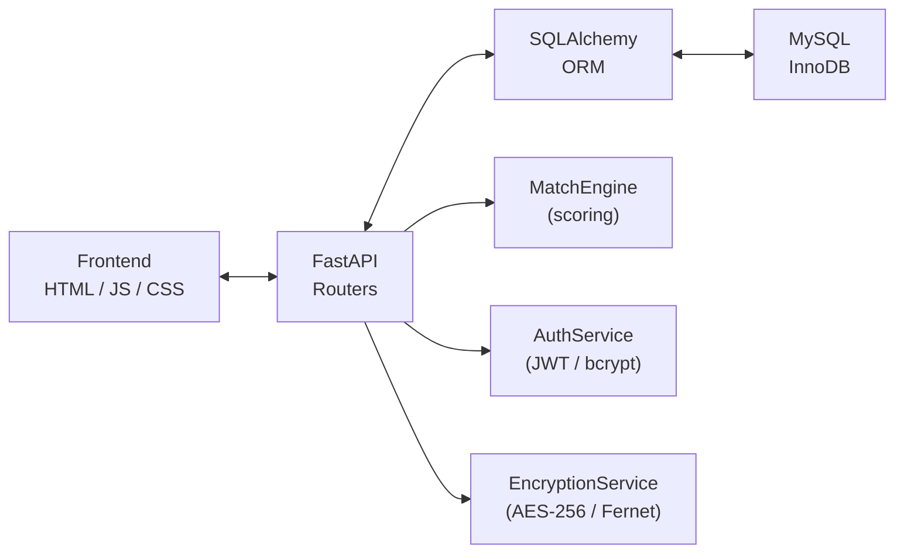

<div align="center">

# ⚖️ BidForge

### Freelance Marketplace Bidding Engine

A full-stack marketplace platform with a **composite scoring engine** that ranks bids by skill match, price fit, and freelancer reputation — not just lowest price.


[](LICENSE)

[Features](#-features) · [Architecture](#-architecture) · [Getting Started](#-getting-started) · [API](#-api-reference) · [Scoring Algorithm](#-scoring-algorithm) · [Testing](#-testing)

</div>

---

## ✨ Features

- **Composite bid scoring** — weighted algorithm combining skill overlap, price fit, and freelancer rating into a single 0–1 match score
- **Extensible scoring engine** — polymorphic `MatchEngine` with overridable components; ships with a `WeightedSkillMatchEngine` variant that prioritizes critical skills
- **Encapsulated project lifecycle** — state machine (`Open → InProgress → Completed`) with dual-party completion confirmation
- **Role-based access control** — JWT authentication with client/freelancer role separation, enforced at both API and database layers
- **MySQL-native data integrity** — CHECK constraints, BEFORE/AFTER triggers, stored procedures, foreign keys, and covering indexes
- **AES-256 encryption** — column-level encryption for sensitive data via Fernet
- **Audit trail** — automatic change logging via database triggers
- **Heap-based ranking** — `RankedBidQueue` using `heapq` with O(1) lazy deletion and inverted comparators for max-heap behavior
- **106 automated tests** — unit, integration, and database-level tests with full lifecycle coverage

---

## 🏗️ Architecture



### Tech Stack

| Layer | Technology |
|-------|-----------|
| API | Python 3.14, FastAPI, Pydantic v2 |
| ORM | SQLAlchemy (declarative models) |
| Database | MySQL 26.7 (InnoDB) via PyMySQL |
| Auth | bcrypt + JWT (python-jose) |
| Encryption | AES-256 via Fernet (cryptography) |
| Frontend | Vanilla HTML / CSS / JS |
| Testing | pytest, FastAPI TestClient |

### Key Design Decisions

| Decision | Rationale |
|----------|-----------|
| **ABC hierarchy for user roles** | `UserBase(ABC)` → `ClientUser` / `FreelancerUser` enforces role contracts at the type level; factory method `get_user_type()` returns the correct subclass |
| **Inverted `__lt__` on `BidRanked`** | `@dataclass` with flipped comparison operators turns Python's min-heap into a max-heap without negating scores |
| **Lazy deletion in `RankedBidQueue`** | O(1) removal via index dict; stale entries cleaned on next `pop()`/`peek()` — avoids O(n) heap restructuring |
| **Encapsulated status machine** | `Project.accept_bid()` / `mark_completed_by()` are the only way to change status; raises domain exceptions on invalid transitions |
| **Database-level triggers** | BEFORE INSERT triggers validate bids and budgets; AFTER triggers maintain audit log and auto-update freelancer rating averages |
| **Stored procedures** | `sp_get_ranked_bids()`, `sp_freelancer_stats()`, `sp_bid_summary_cursor()` push ranking and aggregation logic to the database layer |
| **Module-level singleton** | Fernet cipher instantiated once at import; avoids repeated key derivation |

### Project Structure

```
freelance-marketplace/
├── backend/
│   ├── app.py                    # FastAPI app factory, middleware, lifespan
│   ├── config.py                 # Environment-driven configuration
│   ├── database.py               # Engine, session factory, triggers, stored procedures
│   ├── dependencies.py           # DI: get_db, get_current_user, require_role()
│   ├── exceptions.py             # 5 domain exceptions
│   ├── models/
│   │   ├── enums.py              # ProjectStatus, UserRole
│   │   ├── user.py               # User (ORM) + UserBase ABC hierarchy + FreelancerProfile
│   │   ├── project.py            # Project with encapsulated status machine
│   │   └── bid.py                # Bid (ORM) + BidRanked (dataclass) + Rating
│   ├── schemas/                  # Pydantic v2 request/response validation
│   ├── routers/
│   │   ├── auth.py               # Registration, JWT login, profile
│   │   ├── projects.py           # CRUD, bid acceptance, dual-completion
│   │   ├── bids.py               # Submission (auto-scored), ranked listing
│   │   ├── freelancers.py        # Profile management
│   │   └── admin.py              # EXPLAIN, ACID demo, stored procedures, audit log
│   └── services/
│       ├── auth_service.py       # bcrypt + JWT
│       ├── match_engine.py       # MatchEngine + WeightedSkillMatchEngine
│       ├── ranking.py            # RankedBidQueue (heapq)
│       ├── encryption.py         # AES-256 column encryption
│       ├── query_analyzer.py     # EXPLAIN wrapper, index analysis
│       └── transaction_manager.py
├── frontend/                     # Vanilla HTML/CSS/JS
├── docs/
│   ├── dbms.md                   # Database design documentation
│   └── oops.md                   # OOP patterns and class diagram
├── scripts/sql/                  # DDL, DML, DCL, triggers, procedures, transactions
├── tests/                        # 106 tests (unit + integration + DB)
├── seed.py                       # Demo data seeder
├── run.py                        # uvicorn entry point
├── requirements.txt
└── LICENSE
```

### Database Schema (6 tables, MySQL InnoDB)

```
users (id, username, email, password_hash, role, created_at)
  │    CHECK: role IN ('client', 'freelancer')
  │
  ├──→ freelancer_profiles (user_id FK, skills JSON, hourly_rate, avg_rating, total_ratings)
  │    CHECK: hourly_rate >= 0, 0 <= avg_rating <= 5
  │
  ├──→ projects (client_id FK, title, description, required_skills JSON,
  │              budget_min, budget_max, deadline, status, accepted_bid_id FK,
  │              client_completed, freelancer_completed, created_at)
  │    CHECK: budget_min >= 0, budget_max > 0, status IN ('open','in_progress','completed')
  │
  ├──→ bids (project_id FK, freelancer_id FK, amount, proposal, match_score, created_at)
  │    UNIQUE(project_id, freelancer_id), CHECK: amount > 0, 0 <= match_score <= 1
  │
  ├──→ ratings (project_id FK, freelancer_id FK, client_id FK, score, review, created_at)
  │    UNIQUE(project_id), CHECK: 1 <= score <= 5
  │
  └──→ audit_log (table_name, record_id, action, old_value, new_value, changed_at)
       Auto-populated by AFTER UPDATE trigger
```

**Triggers:** `trg_before_insert_bid`, `trg_before_insert_project`, `trg_after_insert_rating`, `trg_after_update_project_status`

**Indexes:** `idx_bids_project_score` (covering), `idx_bids_freelancer`, `idx_projects_status`, `idx_projects_client`, `idx_ratings_freelancer`

**Stored Procs:** `sp_get_ranked_bids()`, `sp_freelancer_stats()`, `sp_bid_summary_cursor()`

---

## 🚀 Getting Started

### Prerequisites

- Python 3.10+
- MySQL 8.0+

### Setup

```bash
# Clone
git clone https://github.com/dhyeyjoshi07/Freelance-Marketplace-Bidding-Engine.git
cd Freelance-Marketplace-Bidding-Engine

# Environment
python3 -m venv venv && source venv/bin/activate
pip install -r requirements.txt

# Database
brew services start mysql    # macOS
mysql -u root -e "
  CREATE DATABASE IF NOT EXISTS bidforge CHARACTER SET utf8mb4 COLLATE utf8mb4_unicode_ci;
  CREATE DATABASE IF NOT EXISTS bidforge_test CHARACTER SET utf8mb4 COLLATE utf8mb4_unicode_ci;
  CREATE USER IF NOT EXISTS 'bidforge_user'@'localhost' IDENTIFIED BY 'bidforge_pass';
  GRANT ALL PRIVILEGES ON bidforge.* TO 'bidforge_user'@'localhost';
  GRANT ALL PRIVILEGES ON bidforge_test.* TO 'bidforge_user'@'localhost';
  FLUSH PRIVILEGES;
"

# Seed rich demo data (8 clients, 15 freelancers, 18 projects, 54 bids, 4 reviews)
python3 seed.py

# Run the server
python3 run.py
```

Open **http://localhost:8000** in your browser.

### 🔑 Demo Accounts (after seeding)

All demo accounts use password: `password123`

| Role | Username | Organization / Profile | Domain & Stack |
|------|----------|------------------------|----------------|
| Client | `sarah_chen` | TechCorp — Senior Product Manager | Microservices, Observability, Analytics |
| Client | `alex_rivera` | NextGen AI — Founder & CEO | ML Inference, Systems, Rust |
| Client | `elena_rostova` | FinPulse — Head of Engineering | FinTech, WebSockets, Kafka Streaming |
| Client | `morgan_wu` | PixelForge Agency — Creative Director | Mobile Apps, Design Systems, GraphQL |
| Freelancer | `dev_alice` | Senior Backend Engineer ($85/hr) | Python, FastAPI, SQL, Docker, AWS |
| Freelancer | `dev_charlie` | Full-Stack Architect ($95/hr) | Python, React, Redis, GraphQL |
| Freelancer | `dev_diana` | ML Infrastructure Specialist ($125/hr) | PyTorch, TensorFlow, Python, Docker |
| Freelancer | `dev_fiona` | Cloud & Distributed Systems ($110/hr) | Go, Kubernetes, Microservices, AWS |
| Freelancer | `dev_hannah` | High-Performance Systems ($135/hr) | Rust, WebAssembly, C++, Linux |
| Freelancer | `dev_bob` | Frontend Specialist ($70/hr) | React, TypeScript, Node.js, Tailwind |

> 💡 **Marketplace Activity Included:** The database is pre-seeded with **10 Open projects** (with ranked bids ready for review), **4 In-Progress projects** (with active contracts), and **4 Completed projects** (with verified dual confirmations, star ratings, and written reviews).

---

## 🔌 API Reference

### Auth — registration, JWT login, profile

| Method | Endpoint | Description |
|--------|----------|-------------|
| POST | `/api/auth/register` | Register as client or freelancer |
| POST | `/api/auth/login` | Authenticate, returns JWT |
| GET | `/api/auth/me` | Current user profile |

### Projects — CRUD, bid acceptance, dual-completion

| Method | Endpoint | Description |
|--------|----------|-------------|
| POST | `/api/projects` | Create project (client only) |
| GET | `/api/projects` | List open projects |
| GET | `/api/projects/my` | Current user's projects |
| GET | `/api/projects/{id}` | Project detail |
| POST | `/api/projects/{id}/accept-bid` | Accept bid → InProgress |
| POST | `/api/projects/{id}/complete` | Mark complete (dual-confirm) |
| POST | `/api/projects/{id}/rate` | Rate freelancer (1–5) |

### Bids — submission and ranked listing

| Method | Endpoint | Description |
|--------|----------|-------------|
| POST | `/api/projects/{id}/bids` | Submit bid (auto-scored) |
| GET | `/api/projects/{id}/bids` | Ranked bid list |
| GET | `/api/freelancers/me/bids` | Freelancer's own bids |

### Freelancers — profile management

| Method | Endpoint | Description |
|--------|----------|-------------|
| GET | `/api/freelancers/me` | View profile |
| PUT | `/api/freelancers/me` | Update skills / hourly rate |

### Admin — database introspection and diagnostics

| Method | Endpoint | Description |
|--------|----------|-------------|
| GET | `/api/admin/explain?query=...` | EXPLAIN query plan |
| GET | `/api/admin/table-stats/{table}` | Optimizer statistics |
| GET | `/api/admin/query-optimization-demo` | Index performance comparison |
| GET | `/api/admin/stored-procedure/ranked-bids/{id}` | Execute `sp_get_ranked_bids` |
| GET | `/api/admin/stored-procedure/freelancer-stats/{id}` | Execute `sp_freelancer_stats` |
| GET | `/api/admin/audit-log` | View change audit trail |
| GET | `/api/admin/triggers` | List database triggers |
| GET | `/api/admin/stored-procedures` | List stored procedures |
| GET | `/api/admin/constraints?table_name=...` | List constraints |
| POST | `/api/admin/encrypt?plaintext=...` | AES-256 encrypt/decrypt |

---

## 🧮 Scoring Algorithm

Every bid is auto-scored on submission using a weighted composite formula:

```
match_score = 0.45 × skill_overlap + 0.30 × price_fit + 0.25 × rating
```

| Component | Weight | Computation |
|-----------|:------:|-------------|
| Skill overlap | 0.45 | Set intersection of required vs. offered skills — O(min(m, n)) |
| Price fit | 0.30 | 1.0 within budget range; linear decay outside |
| Rating | 0.25 | `avg_rating / 5.0`; new freelancers receive a 0.1 baseline |

All three components are independently overridable via subclassing. `WeightedSkillMatchEngine` demonstrates this by applying a 1.5× multiplier to designated critical skills.

---

## 🧪 Testing

**106 tests** across four test suites:

| Suite | Tests | Scope |
|-------|:-----:|-------|
| `test_models.py` | 40 | Model logic, status machine, constraints, edge cases |
| `test_match_engine.py` | 28 | Scoring algorithm, weight validation, subclass behavior |
| `test_api.py` | 23 | Full API lifecycle (register → bid → complete → rate) |
| `test_dbms.py` | 15 | CHECK constraints, transactions, encryption, triggers |

```bash
python3 -m pytest tests/ -v              # all tests
python3 -m pytest tests/test_api.py -v   # integration only
```

---

## 📄 License

This project is licensed under the **MIT License** — you're free to use, modify, and distribute it for personal or commercial purposes. See the [`LICENSE`](LICENSE) file for full terms.

---

<div align="center">

**Built with** &nbsp; 🐍 Python &nbsp;·&nbsp; ⚡ FastAPI &nbsp;·&nbsp; 🐬 MySQL

</div>
